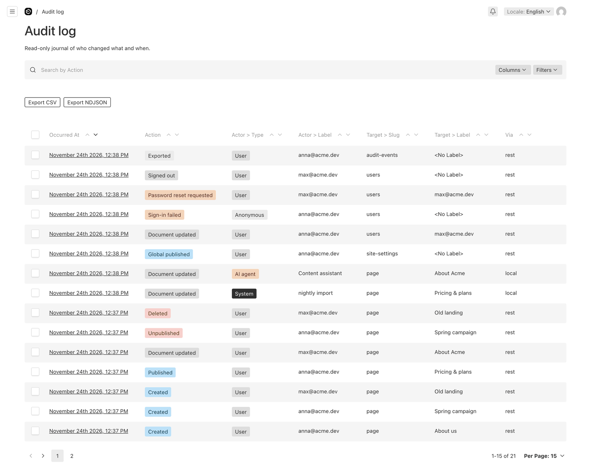
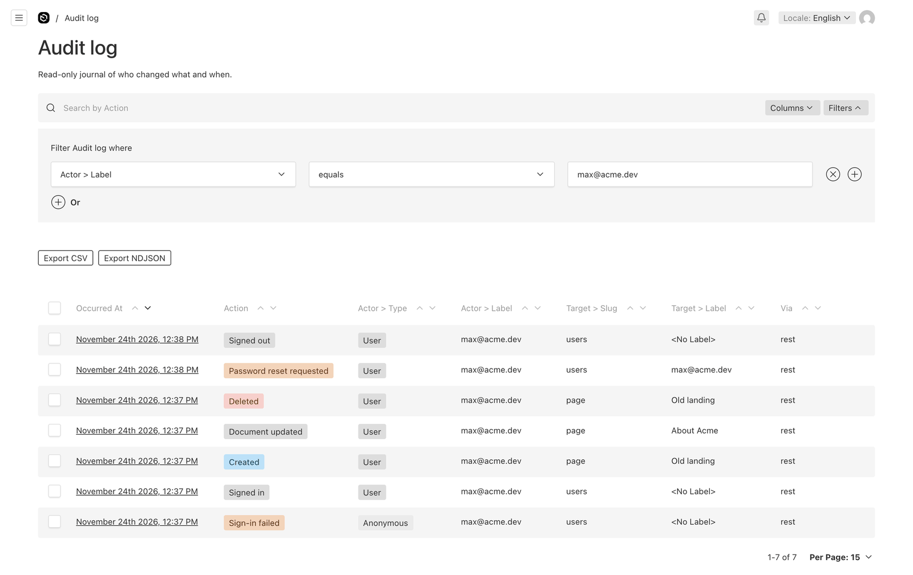
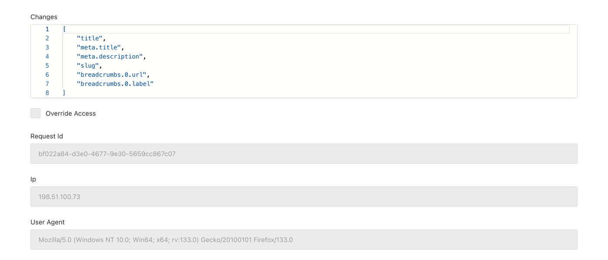

# @focus-reactive/payload-plugin-audit-log

Audit log for [Payload CMS](https://payloadcms.com/) v3: a read-only collection of who changed which document or global and when, plus sign-ins, API keys and AI agents, with CSV / NDJSON export. Only the paths of changed fields are stored, never their values.



| Filter by actor, action or target | Changed field paths, IP and User-Agent |
| --- | --- |
|  |  |

## AI Integration Prompt

> Copy and paste this prompt into your AI assistant (Cursor, Claude, etc.) to integrate the plugin into an existing Payload project.

```
Add an audit log to my Payload CMS v3 project with @focus-reactive/payload-plugin-audit-log.

What it does: adds a read-only collection "audit-events" (admin group "Settings") that records document and
global changes (create, update, delete, publish, unpublish, version restore), sign-ins, sign-outs, failed
sign-ins and password resets. Each event stores the actor (user, API key, MCP agent, system, anonymous), the
target, the paths of changed fields (never values), IP and User-Agent. Nobody can edit or delete events.

1. Install: bun add @focus-reactive/payload-plugin-audit-log
   (payload and @payloadcms/ui 3.90+, react 19; Postgres, SQLite or MongoDB)

2. In payload.config.ts, add it after plugins that create collections or globals:

   import { auditLogPlugin } from '@focus-reactive/payload-plugin-audit-log'

   auditLogPlugin({
     access: { read: ({ req }) => Boolean(req.user) }, // who can read and export; restrict to admins
     retention: { days: 365 },                          // optional, default: keep forever
   })

   With @payloadcms/plugin-mcp (order: 10), set a higher order so MCP keys and agents are audited:
   Object.assign(auditLogPlugin({ ... }), { order: 11 })

3. Run: payload generate:importmap
   On Postgres / SQLite also: payload migrate:create add_audit_log && payload migrate

4. Scripts and agents: wrap Local API calls to name the actor, otherwise they are logged as "system":

   import { withAuditActor } from '@focus-reactive/payload-plugin-audit-log'
   await withAuditActor({ type: 'system', label: 'nightly import' }, () => payload.update({ ... }))

5. With retention, make sure jobs run (jobs.autoRun, or a cron calling payload.jobs.run()).

Check: edit and publish a document, sign in with a wrong password, then open Settings → Audit log and
export CSV. Custom events (for example SSO logins): see logAuditEvent in the plugin README.
```

## Install

```bash
bun add @focus-reactive/payload-plugin-audit-log
```

```ts
import { buildConfig } from "payload";
import { auditLogPlugin } from "@focus-reactive/payload-plugin-audit-log";

export default buildConfig({
  plugins: [auditLogPlugin({ retention: { days: 365 } })],
});
```

- Requires `payload` and `@payloadcms/ui` 3.90+, `react` 19.
- Databases: Postgres, SQLite, MongoDB. On Postgres / SQLite run `payload migrate:create` and `payload migrate` after installing and after upgrades that change select options.
- Run `payload generate:importmap` for the export buttons.
- Place the plugin after plugins that add collections or globals. `@payloadcms/plugin-mcp` has `order: 10`, so give the audit plugin a higher `order` to audit its API keys.

## Events

| Action | When |
| --- | --- |
| `doc.create` | A document is created or duplicated |
| `doc.update` | A document is changed, moved to trash or restored from trash |
| `doc.delete` | A document is deleted permanently |
| `doc.publish` / `doc.unpublish` | A document's status changes to / from `published` |
| `doc.restore` | A version is restored |
| `global.update` / `global.publish` / `global.unpublish` | A global is changed, published or unpublished |
| `auth.login` / `auth.logout` | Login or logout through Payload |
| `auth.login_failed` | Failed REST or GraphQL login (`metadata.reason`: `invalid_credentials` or `locked`) |
| `auth.password_reset_requested` / `auth.password_reset` | Forgot-password and reset-password |
| `audit.export` / `audit.retention_purge` | The log was exported or purged |

- Only Payload operations and hooks are recorded. Raw `payload.db` calls and SQL get no events; seeds and migrations get none of their own. Local API calls without a user are recorded with the `system` actor.
- Role changes and API key changes are plain `doc.update` / `doc.create` / `doc.delete` events of the user or key collection.
- Autosave draft saves are not logged.
- `changes` lists changed field paths. Array and block rows are matched by id: an edited row gives `items.2.title`, an added row `items.2`, a removed or reordered row `items`. JSON and rich text fields are reported by their own path.
- Event fields: `occurredAt`, `action`, `status`, `actor`, `onBehalfOf`, `agent`, `via`, `target` (`kind`, `slug`, `docId`, `label`, `locale`), `changes`, `overrideAccess`, `requestId`, `ip`, `userAgent`, `metadata`.

## Actors

- `user`: a signed-in user.
- `api_key`: a request authenticated with a Payload API key.
- `agent`: an MCP request, or code that sets the actor to `agent`.
- `system`: a Local API call without a user.
- `anonymous`: a request without a user.

`withAuditActor` labels every Local API call inside the callback. `req.context.auditActor` (`CTX_ACTOR`) sets the actor for one request.

```ts
import { withAuditActor } from "@focus-reactive/payload-plugin-audit-log";

await withAuditActor({ type: "system", label: "initial content" }, async () => {
  await payload.create({ collection: "pages", data: { title: "Home" } });
});
```

`logAuditEvent(payload, { action, target, status?, changes?, overrideAccess?, metadata?, actorOverride?, req?, headers? })` writes a custom event, such as an SSO login. It does nothing when the plugin is not installed or disabled.

## Options

| Option | Default | Meaning |
| --- | --- | --- |
| `enabled` | `true` | `false` leaves the config untouched |
| `slug` | `"audit-events"` | Slug of the log collection |
| `excludeCollections` | `[]` | Collections not to log; the log itself is always excluded |
| `excludeGlobals` | `[]` | Globals not to log |
| `retention` | not set | `{ days, queue?, cron? }`: delete events older than `days` (1–36500) |
| `access.read` | users of the admin user collection | Who can read and export the log |
| `recordIpAndUserAgent` | `true` | Store `ip` and `userAgent` from request headers |
| `maxChangedPaths` | `200` | Maximum entries in `changes`; a longer list ends with `…` |

Invalid `retention.days` or `maxChangedPaths` throws when the config is built.

## Access

Only `access.read` controls reading and export. Events cannot be created, updated or deleted through REST, GraphQL, the admin panel or the Local API, even with `overrideAccess`.

## Export

- `GET /api/<slug>/export?format=csv|ndjson`, with the REST `where` filter and `search`.
- **Export CSV** and **Export NDJSON** buttons in the admin list view keep the current filter and search.
- At most 100,000 rows per request. Each export writes an `audit.export` event.

## Retention

`retention.days` registers a job that runs daily at 03:00 on queue `default` (override with `cron` / `queue`). It requires a jobs runner: `jobs.autoRun` or an external call to `payload.jobs.handleSchedules()` and `payload.jobs.run()`. Without retention events are kept forever.

## Performance

- Reads (`find`, `findByID`, `findGlobal`, REST GET) are unaffected.
- On Postgres a write takes 0.6–2 ms longer; bulk updates about 1.25 ms per document.
- Two saves read the stored document once more (about 4.5 ms):
  - a publish by id over a draft in an autosave collection;
  - a save by id that is neither a draft save nor a publish while the latest version is a draft.
- Each event takes 0.5–0.6 KB including indexes. The admin list count and search box scan the table, so set `retention.days`.

## Limitations

- Writes outside Payload operations (raw SQL, `payload.db`, direct database access) are not audited, by design.
- No hash chain: rows can be changed by anyone with database access.
- Without a transaction, a failed save keeps what it already wrote: a change may have no event, or an event may remain for a failed save.
- On MongoDB, events are written after commit; if the process stops in between, the change has no event.
- Agents outside MCP are recorded as agents only if they set the actor.
- Fields cleared by the database (`ON DELETE SET NULL`) are not recorded.
- Failed logins through the Local API and aliased GraphQL login mutations are not recorded.
- `ip` and `userAgent` come from client headers; trust `ip` only behind a proxy that sets `x-forwarded-for`.
- `job` in `via` is never detected; label task handlers to get it.

## License

MIT
