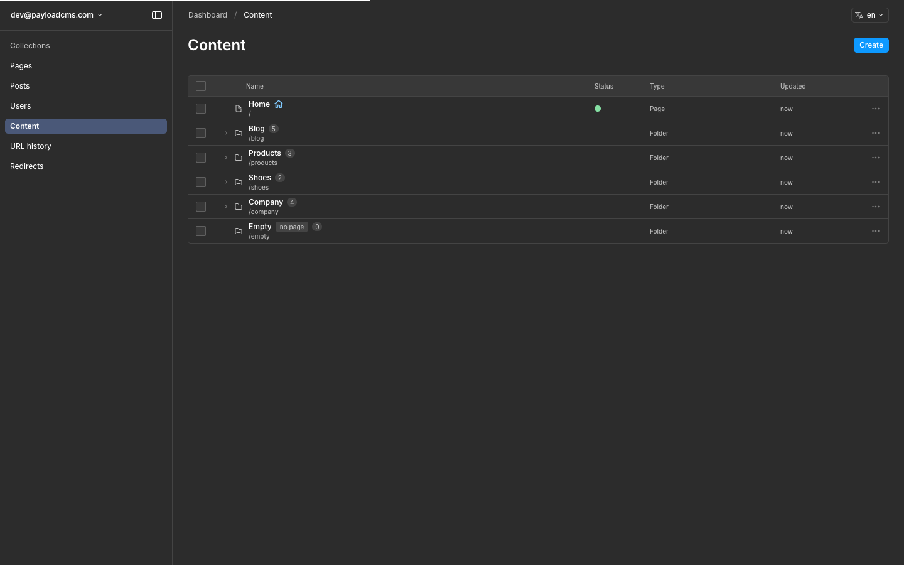
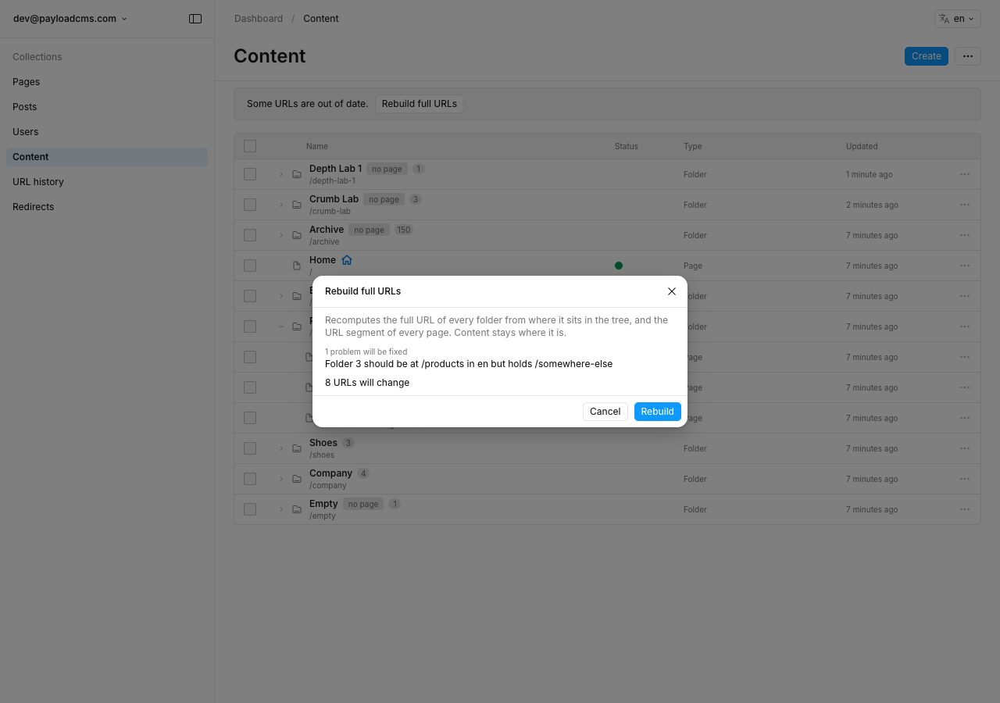
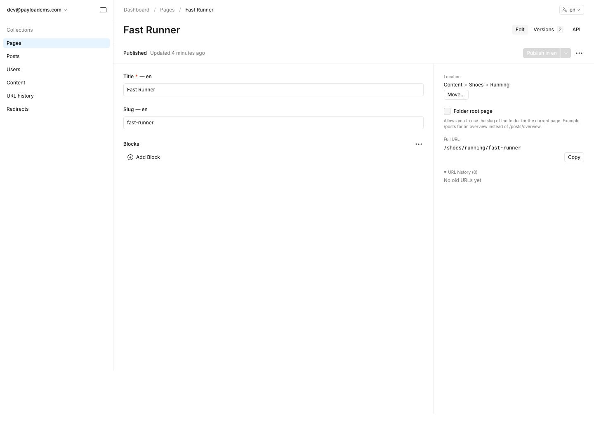
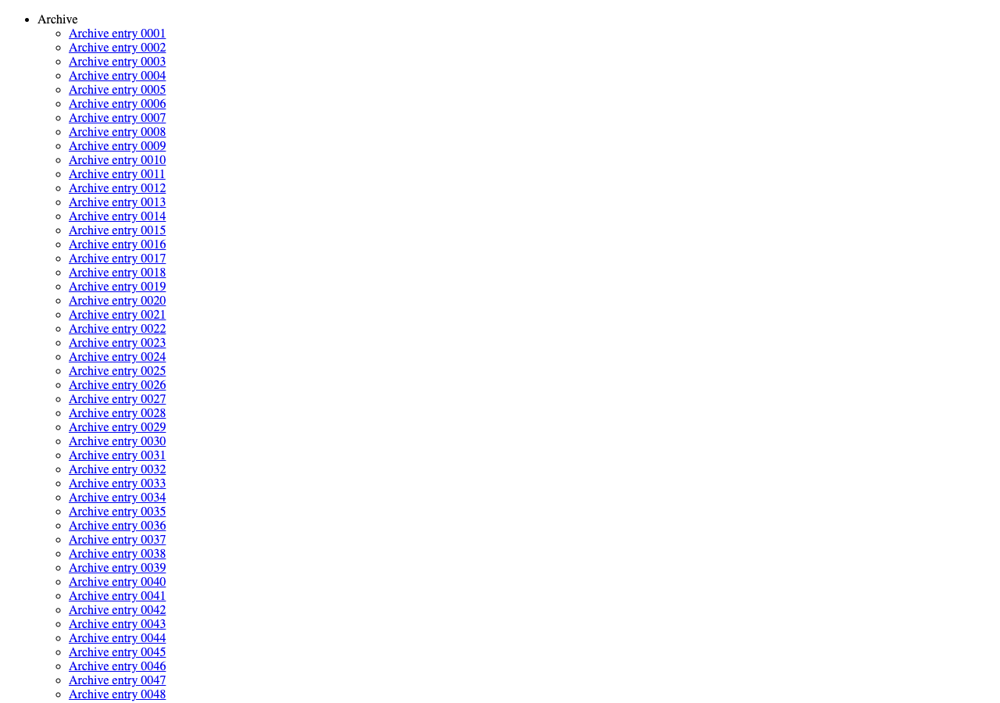
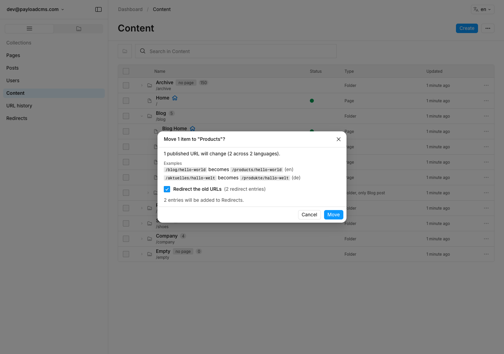
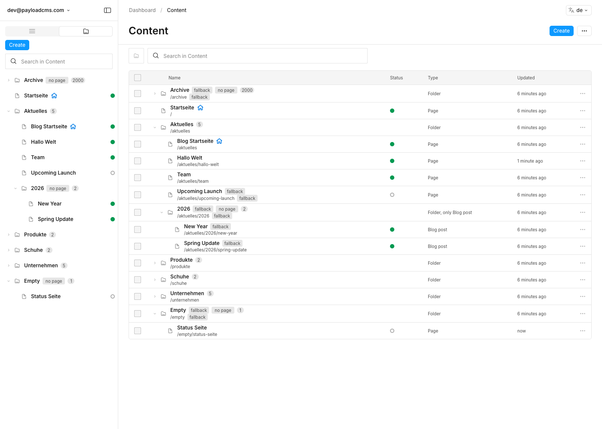
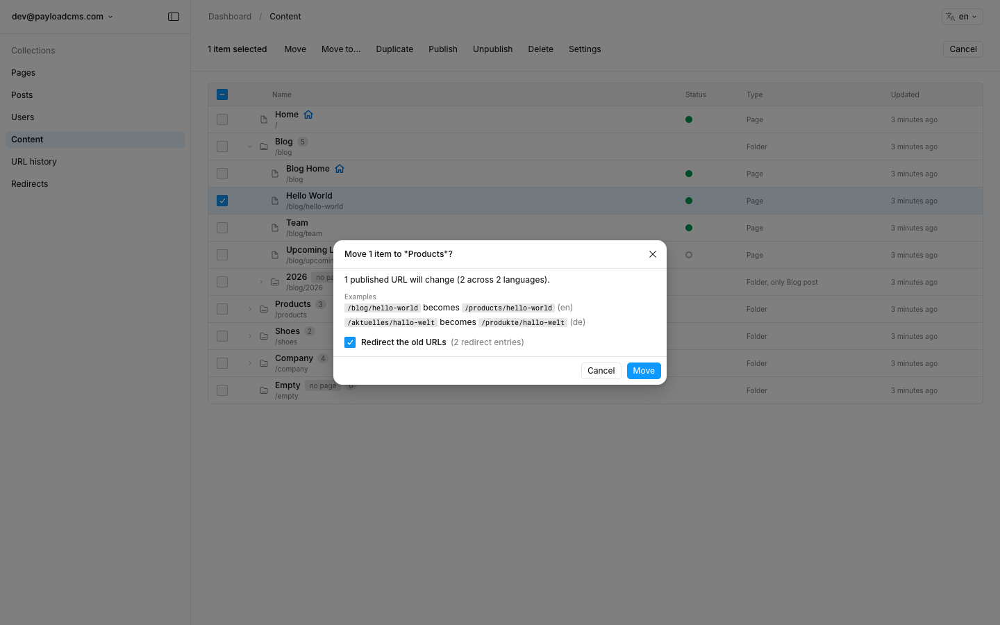
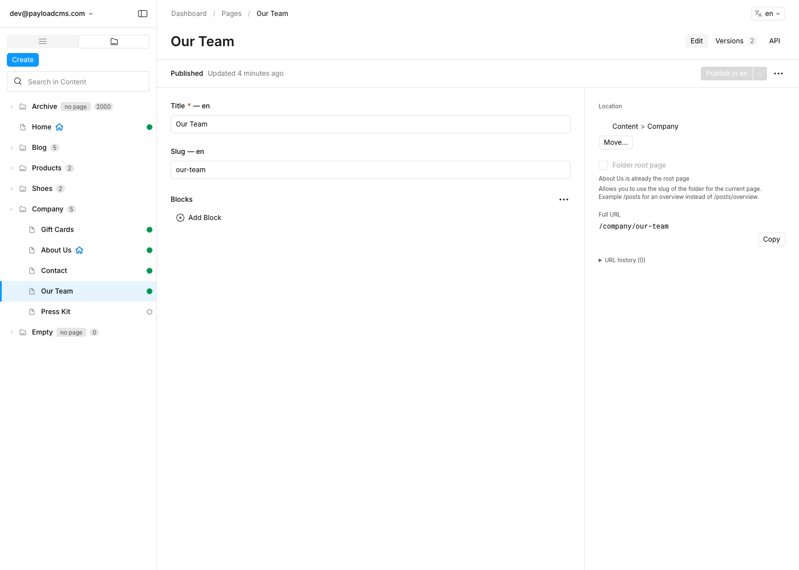
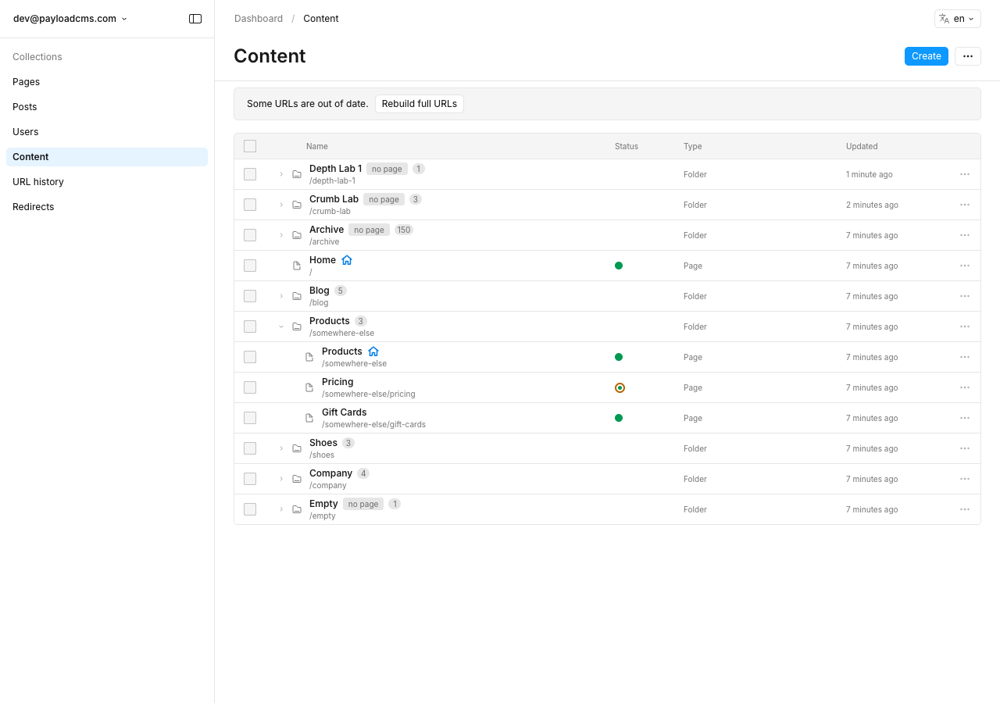

# @focus-reactive/payload-plugin-folders

A Storyblok-style content tree for Payload 4. Folders, per-folder ordering, full URLs, moves and
renames with redirects, and an admin tree with drag and drop.



The package is private for now and is not on npm. Everything below describes the package as you
would install it. Until it is published, the app in `dev/` is the working example.

Contents: [Install](#install), [Install on existing content](#install-on-existing-content),
[Configuration reference](#configuration-reference), [Data model](#data-model),
[Reading content](#reading-content), [Frontend recipes](#frontend-recipes),
[Redirects and the mirror](#redirects-and-the-redirects-plugin-mirror), [Access](#access),
[Locales](#locales), [The admin](#the-admin), [Verify and repair](#verify-and-repair),
[The tree lock](#the-tree-lock), [Limitations](#limitations),
[Dev app, seed and tests](#dev-app-seed-and-tests).

## What you get

- A `folders` collection and a handful of fields on the page collections you opt in. Every page gets
  `fullPath`, such as `/blog/2026/new-year`, on every read: REST, GraphQL and the Local API.
- Moves, reorders and folder renames that rewrite every affected URL in one database transaction,
  and write redirect rows for the old URLs.
- A root page per folder: the page that answers at the folder's own URL.
- Frontend helpers: resolve a URL to a page, list every path for a sitemap, read the whole tree for
  navigation, and follow redirects. They come as a Local API module and as a REST client.
- An admin tree view (the "Content" section), a Tree tab in the sidebar, drag and drop, a keyboard
  map, search, Move mode, confirm dialogs with URL counts, undo, batches for large changes, and a
  repair action for content that already existed.

## Install

### Requirements

| What | Version |
|---|---|
| Payload and `@payloadcms/ui` | `^4.0.0-beta.5` (peer dependencies) |
| React and React DOM | `^19` (peer dependencies) |
| Node | 24.22.1 or newer |
| Database | SQLite or Postgres through Payload's official adapters |
| `@payloadcms/plugin-redirects` | only when you turn on `redirects.mirrorToRedirectsPlugin` |

The plugin depends on `@dnd-kit/core` and `@tanstack/react-virtual`. It uses no `next/*` import in
its admin code.

MongoDB is refused at config time: the plugin needs relational transactions and partial version
writes. Payload 3 is not supported.

### Add the plugin

Opt in the page collections by slug and pass the plugin to `buildConfig`. This is a complete
config for a SQLite app with English and German:

```ts
import { sqliteAdapter } from "@payloadcms/db-sqlite";
import { redirectsPlugin } from "@payloadcms/plugin-redirects";
import { buildConfig } from "payload";
import type { CollectionConfig } from "payload";

import { foldersPlugin } from "@focus-reactive/payload-plugin-folders";

const Pages: CollectionConfig = {
  slug: "pages",
  admin: { useAsTitle: "title" },
  fields: [
    { name: "title", type: "text", localized: true, required: true },
    { name: "slug", type: "text", localized: true },
  ],
  versions: { drafts: true },
};

const Posts: CollectionConfig = {
  slug: "posts",
  admin: { useAsTitle: "title" },
  fields: [{ name: "title", type: "text", required: true }],
};

const Users: CollectionConfig = { slug: "users", auth: true, fields: [] };

export default buildConfig({
  collections: [Pages, Posts, Users],
  db: sqliteAdapter({
    client: { url: process.env.DATABASE_URI ?? "file:./app.db" },
    // Required: without it SQLite has no transactions. See "SQLite needs transactionOptions".
    transactionOptions: {},
  }),
  localization: { defaultLocale: "en", fallback: true, locales: ["en", "de"] },
  plugins: [
    foldersPlugin({
      collections: { pages: true, posts: { label: "Blog post" } },
      redirects: { mirrorToRedirectsPlugin: true },
    }),
    redirectsPlugin({ collections: ["pages", "posts"] }),
  ],
  secret: process.env.PAYLOAD_SECRET ?? "",
});
```

The plugin only sees collections that are already in the config when it runs. A collection added
by a plugin that comes later in `plugins` cannot be opted in.

### SQLite needs transactionOptions

Payload's SQLite adapter does nothing in `beginTransaction` unless you pass `transactionOptions`.
Without it a failed move can leave half of its writes, and a page save that the uniqueness check
refuses after writing stays written. The plugin logs a warning at startup when it finds this.
Pass `transactionOptions: {}`, as the config above does.

### Postgres

Nothing special. Size the pool for your write concurrency: tree writes queue on a lock, and each
queued write holds one pool connection while it waits.

```ts
import { postgresAdapter } from "@payloadcms/db-postgres";

export const db = postgresAdapter({
  pool: { connectionString: process.env.DATABASE_URL, max: 20 },
});
```

The plugin adds a `mirrorRedirects` value to the `kind` select of `folder-operations`. A Postgres
database that uses migrations needs a new migration for that enum value when you update.

### After installing

1. Run `payload generate:importmap`. The plugin registers admin components, such as the tree view,
   as import-map entries. Payload does this on startup in development.
2. Create the schema: `payload migrate:create` and `payload migrate` on a database with migrations,
   or let the adapter push the schema in development.
3. Start the app. The first start creates the `folders-tree-state` row that the tree lock uses.

The plugin throws one `FoldersConfigError` that lists every problem it found:

- An opted-in slug that is not in the config, or is the folders collection itself.
- A page collection that already has a field named `folder`, `orderKey`, `structureRevision`,
  `isFolderRoot`, `pathSegment`, `folderPath`, `fullPath`, `folderUrlHistory` or
  `folderDraftWarning`.
- A Payload core folder field (`_h_<slug>`) on a page collection. The two folder systems cannot
  share a collection.
- A `segmentField` that exists and is not a text field.
- `localizeSegments: true` with no `localization` in the config.
- A slug already taken: the folders collection, `folder-redirects`, `folder-operations` or the
  `folders-tree-state` global.
- A MongoDB adapter.
- `redirects.mirrorToRedirectsPlugin: true` without `@payloadcms/plugin-redirects` in `plugins`.
- A limit, `maxDepth` or `admin.pageSize` that is not a positive whole number.

Warnings go to the Payload logger at startup. The plugin warns about a SQLite adapter without
`transactionOptions`, about a unique segment field (below), about a collection that also uses
`@payloadcms/plugin-nested-docs`, and about a locale whose `fallbackLocale` is not the default
locale (see Locales).

**A unique slug field loses its index.** The same segment must be allowed in two folders, so the
plugin removes `unique` from the segment field and keeps a plain index. The next migration drops
the unique index.

### Why this package sits outside the repository's bun workspace

The repository root pins `payload` and every `@payloadcms/*` package to 3.90.1 through `overrides`
with a hoisted linker. Inside the workspace this package would build against Payload 3. So the root
`package.json` excludes it with `"!packages/payload-plugin-folders"`, and the package is its own
npm project with its own `package-lock.json`. Work in it with `npm`, not `bun`.

## Install on existing content

Pages that existed before the plugin have no folder, no order key and a null `pathSegment`. Every
page starts at the site root.

**Warning: run repair before you deploy a frontend that reads the plugin's paths.** Between the
install and the repair every page that existed before the plugin has a null `pathSegment`, so its
`fullPath` is null. `resolvePath`, `getTree` and `getAllPaths` skip such a page, except a folder's
root page, whose path is its folder's. A frontend built on them answers 404 for those pages, leaves
them out of the navigation and leaves them out of the sitemap until repair has run.

Do this once, in order:

1. Install the plugin and create the schema (above).
2. Run a dry run and read it. It writes nothing:

   ```text
   npx payload run node_modules/@focus-reactive/payload-plugin-folders/dist/bin/repair.js -- --dry-run
   ```

   In a checkout of this repository the same thing is `npm run repair -- --dry-run`, which builds
   first and points `payload run` at the dev config. After `npm run build` you can also call
   `PAYLOAD_CONFIG_PATH=./dev/payload.config.ts npx payload run dist/bin/repair.js -- --dry-run`.
3. Run the repair itself, without `--dry-run`. It backfills `pathSegment`, gives pages an order key
   and rewrites folder paths. `--no-redirects` writes no redirect rows for the URLs that change.
4. Read the conflict list at the end. Repair never fixes a conflict, it only lists it. See below.
5. Move content into folders in the admin.

You can run the same repair from code, or from the admin, where the Content header menu has
"Rebuild full URLs". That action shows the dry-run list first and is only offered to users who
pass `access.repair`.

```ts
import config from "@payload-config";
import { repairTree, verifyTree } from "@focus-reactive/payload-plugin-folders/server";
import { getPayload } from "payload";

const payload = await getPayload({ config });

// Reads everything, writes nothing.
const verified = await verifyTree(payload);
console.log(verified.fixable, verified.conflicts);

const dryRun = await repairTree(payload, { dryRun: true });
console.log(dryRun.fixed.total, dryRun.conflicts.total, dryRun.isLarge);

const result = await repairTree(payload);
for (const issue of result.conflicts.issues) {
  console.log(issue.kind, issue.message);
}
```

### What repair fixes, and what it only lists

Fixed, because there is one right answer:

- Folder `fullPath`, `ancestorIds` and `depth`, recomputed from the `parent` chain.
- A folder cycle, broken by moving the lowest-id folder to the top level. A folder whose parent no
  longer exists goes to the top level too.
- A missing `pathSegment`, and a legacy segment that differs from its slug only in capitals. The
  capitals-only fix lowercases the segment. It writes a redirect row from the old URL only when the
  capitalised segment was already saved in `pathSegment`. A page from before the plugin has a null
  `pathSegment`, so repair has no old URL to record and writes no row for it. Its capitalised URL is
  then answered by the resolver, which redirects it to the lowercase one.
- Missing and equal order keys among siblings, in `createdAt` order after the keyed rows.
- A latest version whose folder, order key or structure revision differs from the main row. The
  fix keeps a draft's own different segment.
- Redirect rows whose target is gone.

Listed for a person to settle:

- A page with a saved segment that another page also claims in the same folder.
- A folder whose new path a folder or a live page already holds, and everything beneath it.
- A folder whose segment the site reserves at the top level, such as `api` or `admin`.
- A legacy segment that fails the segment pattern, other than a capitals-only one.
- A folder with no slug, and a second `folders-tree-state` row.

Pages with no saved segment that share a slug are all given that segment, because repair does not
guess which one should change. The clash is then listed as a conflict. Until you rename one of the
pages, the resolver serves the oldest page at the shared path.



Repair re-reads under the tree lock and writes the whole tree in one transaction. Every page save
waits for it. The dialog warns when the writes exceed `limits.maxSyncDocuments`. On a large site run
the command line version, with traffic stopped if you can.

Writes that skip the plugin, such as raw `payload.db` writes, migrations, and a period with
`disabled: true`, are what verify and repair exist for. Run repair after turning the plugin back on.

## Configuration reference

Every option, with its default. The first block is complete, so you can copy it and delete lines.

```ts
import type { FoldersPluginOptions } from "@focus-reactive/payload-plugin-folders";

export const options: FoldersPluginOptions = {
  collections: {
    pages: { label: "Page", segmentField: "slug", titleField: "title" },
    posts: true,
  },
  folders: {
    slug: "folders",
    labels: { singular: { de: "Ordner", en: "Folder" }, plural: { de: "Inhalt", en: "Content" } },
    access: { read: () => true },
    overrides: (collection) => collection,
  },
  maxDepth: 20,
  reservedRootSegments: ["checkout"],
  newItemPosition: "top",
  enforceAllowedTypesOnMove: true,
  localizeSegments: true,
  limits: { maxItemsPerMove: 500, maxFoldersPerMove: 2000, maxSyncDocuments: 200 },
  urls: { localePrefix: "non-default" },
  redirects: { enabled: true, mirrorToRedirectsPlugin: false },
  access: {
    move: ({ req }) => Boolean(req.user),
    repair: ({ req }) => Boolean(req.user),
  },
  hooks: {
    afterPathChange: ({ changes, reason }) => {
      console.log(reason, changes.length);
    },
  },
  admin: {
    treeView: true,
    sidebarTab: { label: "Tree" },
    confirmMoves: "urlChange",
    pageSize: 100,
    previewUrl: ({ fullPath, locale }) => `https://example.com${locale ? `/${locale}` : ""}${fullPath}`,
  },
  disabled: false,
};
```

### `collections` (required)

A record of page collection slugs. Each value is `true` or an object:

| Option | Default | What it does |
|---|---|---|
| `segmentField` | `slug` | The field that holds the page's own URL segment. The plugin adds a text field with that name when the collection has none. The field must be text. |
| `titleField` | `admin.useAsTitle`, then `title`, then `id` | The field shown as the page's name in the tree and in the create dialogs. |
| `label` | the collection's singular label | The name in the Create menu and the Type column. |

### `folders`

| Option | Default | What it does |
|---|---|---|
| `slug` | `folders` | The folders collection's slug. |
| `labels.singular` | `{ en: "Folder", de: "Ordner" }` | A string, or a record of text per admin language. |
| `labels.plural` | `{ en: "Content", de: "Inhalt" }` | The nav label. A string or a record, like `singular`. |
| `access` | read is public; create, update and delete need a signed-in user | Merged over the defaults. |
| `overrides` | none | A function that receives the folders collection and returns it changed. |

Folder `read` is public by default, because a page's `folderPath` and the `folder.ancestorIds`
query read the folder with the requester's access. A reader who cannot read folders gets a null
`fullPath`. Restricting folder reads therefore hides URLs: do it knowing that.

### Everything else

| Option | Default | What it does |
|---|---|---|
| `maxDepth` | `20` | The most segments in any full path. A create, move or folder save beyond it is refused. |
| `reservedRootSegments` | none | Top-level segments nothing may take, added to `admin`, `api` (from `config.routes`), `graphql`, `graphql-playground` and `_next`. Checked on create, move, rename and root-level segment edits. |
| `newItemPosition` | `top` | Where a new item lands among its siblings: `top` or `bottom`. |
| `enforceAllowedTypesOnMove` | `true` | A move into a folder that does not allow the page type is blocked. `false` turns the block into a warning. |
| `localizeSegments` | `true` when the config has `localization` | Folder `name` and `slug`, and a segment field the plugin adds, are localized. A segment field you already have keeps its own `localized` setting. |
| `limits.maxItemsPerMove` | `500` | Selected items in one move. |
| `limits.maxFoldersPerMove` | `2000` | Folder rows that one move or rename may rewrite. |
| `limits.maxSyncDocuments` | `200` | Above this many documents, publish, unpublish, delete, duplicate and the redirects mirror run as stepped batches. |
| `urls.localePrefix` | `non-default` | How `buildUrl` and the mirrored redirect rows add a locale prefix: `none`, `non-default` or `all`. Stored paths never carry one. |
| `redirects.enabled` | `true` | Write `folder-redirects` rows for every changed published URL. The confirm dialog can still untick it for one move. |
| `redirects.mirrorToRedirectsPlugin` | `false` | Also write rows into `@payloadcms/plugin-redirects`. That plugin must be registered. |
| `access.move` | none | An extra gate on every move, asked after the `update` and publish checks passed. |
| `access.repair` | users who pass `folders.access.update` and `access.move` | Who may verify and repair, and see "Rebuild full URLs". |
| `hooks.afterPathChange` | none | Runs after commit with every full path that changed. Read the warning in "Reading content" first. |
| `admin.treeView` | `true` | `false` keeps Payload's own folders list. The sidebar tab still works. |
| `admin.sidebarTab` | `{ label: "Tree" }` | `false` removes the Tree tab, or pass a label. |
| `admin.confirmMoves` | `urlChange` | When the admin asks before a move: `urlChange` (a reorder inside one folder never asks), `always` or `never`. |
| `admin.pageSize` | `100` | Rows per request in the tree. The maximum is 1000. A larger value is cut to 1000. |
| `admin.previewUrl` | none | Builds the "View page" link. Without it the menu item is hidden. |
| `disabled` | `false` | Keeps the schema and removes hooks, endpoints and admin UI. Run `repairTree` after turning the plugin back on. |

`@payloadcms/ui` strings live under the `foldersTree` namespace of `config.i18n.translations`, in
English and German. A host that sets the same keys for a language keeps its own.

## Data model



### The `folders` collection

Unversioned, `disableDuplicate: true` (copies go through the plugin's deep duplicate), timestamps
on. It has trash only when every opted-in page collection has trash.

| Field | Notes |
|---|---|
| `name`, `slug` | Required. Localized when `localizeSegments` is on. `slug` is the folder's URL segment. |
| `parent` | Relationship to `folders`. `null` at the top level, never `0`. Changes only through a move. |
| `orderKey` | Fractional key among siblings. Hidden. Written by the plugin only. |
| `fullPath` | Unique per locale, stored, written by hooks only: `/blog/2026`. |
| `ancestorIds` | `/<rootId>/<childId>/`, ancestors only, and `/` at the top level. Slash-delimited, so `contains /12/` is exact. |
| `depth` | Segments in `fullPath`. A top-level folder has depth 1. |
| `structureRevision` | Bumped by every move of this folder. |
| `allowedTypes`, `defaultType`, `lockSubfolderTypes`, `typesLockedBy` | Which page types the folder takes, the type pre-selected in Create, and the lock that copies the allowed types to every subfolder. An empty `allowedTypes` allows every type. |

### Fields added to each opted-in page collection

| Field | Notes |
|---|---|
| `folder` | Relationship to `folders`. `null` is the site root level. Changes only through a move. |
| `orderKey`, `structureRevision` | Position among siblings and a stale-form guard. Written by the plugin only. |
| `isFolderRoot` | Checkbox. The page that answers at the folder's own URL. A page with `folder: null` and `isFolderRoot: true` is the site root page `/`. One per folder. It is content: it follows drafts. |
| `pathSegment` | The page's own segment in each locale, or null where it has none. Hidden. A fallback to the default locale is applied when you query, not stored. |
| `folderPath` | Virtual: the folder's `fullPath`. Null at the site root. You can use it in `where`. |
| `fullPath` | Virtual: `folderPath` plus the segment, composed on read, per locale. You cannot use it in `where`. |
| the segment field (`slug`) | Added only when the collection lacks it. |
| `folderUrlHistory`, `folderDraftWarning` | Admin-only display fields. |

When you read with a `select`, naming `fullPath` also loads `folder`, `folderPath`,
`isFolderRoot` and `pathSegment`, because the path is composed from them.

Structure is live and owned by the main row. `folder`, `orderKey` and `structureRevision` are
written only by a move, which writes the main row and the latest version together. Publishing an old
draft, an autosave from a stale form or a version restore cannot move a page back: a restored
version takes its content, not its folder or position. Segments and `isFolderRoot` are content and
follow draft rules: a draft save changes only the draft path, and publishing changes the live one.
Folders have no drafts, so a folder rename is live at once.

### Plugin collections and the tree state

| Name | Purpose |
|---|---|
| `folder-redirects` | The "URL history". `lookupKey` (`<locale>:<path>`, unique together with `kind`), `fromPath`, `locale`, `kind` (`page` or `folderPrefix`), `target`. A `folderPrefix` row stands for every path beneath it. Logged-in users read and delete rows. Nobody creates or updates them but the plugin. |
| `folder-operations` | Hidden. The progress of a stepped batch: `kind`, `items`, `cursor`, `done`, `total`, `status`, `error`, `createdBy`. Each user reads only their own. |
| `folders-tree-state` | A hidden global. `revision` changes on every tree change and drives the admin's change detection. `lockedAt` is part of the cross-process tree lock. |

### Segment rules

A segment is 1 to 96 characters of lowercase letters and digits, with single `-`, `_` or `.`
separators between them, so it starts and ends with a letter or digit. A site-root segment cannot contain a dot, so
`robots.txt` and `sitemap.xml` stay yours. The server never rewrites a submitted segment. A
segment saved before the plugin is accepted until it is edited. `slugify` and `isValidSegment` are
exported.

Full paths are unique per locale across folders and every opted-in collection:

1. Two non-root pages in a folder cannot share an effective segment.
2. A non-root page cannot share a segment with a subfolder of its folder.
3. At most one page per folder is the root page.
4. Two folders cannot share a `fullPath`. This is also a database constraint.

A draft save passes these rules, and the edit view shows a warning. A save that makes the segment
live (a publish, a publish of every locale, a version restore or a scheduled publish) is checked
again after the write, in the same transaction, and a conflict rolls it back. So two drafts can
share a segment, but only one can publish it. Only published pages count as conflicts, for a move
and for a save alike.

## Reading content

### First: what `afterPathChange` reports

`hooks.afterPathChange` is the place to revalidate caches, but it does not cover every change.
Read this before you rely on it.

- It fires for a folder rename or move through a normal update (`folderUpdate`), a move or reorder
  (`move`), a delete or trash (`delete`) and a repair (`repair`).
- It does not fire when a page is created, when a page is published with a new slug, or when a page
  becomes or stops being a root page. The reason names `create`, `publish` and `rootToggle` exist in
  the type but this version never sends them. Revalidate those from your page collection's own
  `afterChange` hook.
- It runs after the commit, with the tree lock released, and receives a copy of the request that has
  no transaction. Pass that `req` to nested Local API calls as it is.
- A hook that throws is logged and never fails the save. A failed revalidation is silent.
- The `changes` list holds a row per path and locale, so a folder rename over 980 pages reports a
  thousand rows or more in one call.
- Paths carry no locale prefix. Run them through `buildUrl` to get the URL a visitor uses.
- A write that skips the plugin (raw `payload.db` writes, migrations, `disabled: true`) reports
  nothing. Run repair for those.

```ts
import { buildUrl } from "@focus-reactive/payload-plugin-folders";
import type { FoldersPluginOptions } from "@focus-reactive/payload-plugin-folders";
import { revalidatePath } from "next/cache";

type AfterPathChange = NonNullable<NonNullable<FoldersPluginOptions["hooks"]>["afterPathChange"]>;

export const afterPathChange: AfterPathChange = ({ changes }) => {
  const urls = new Set<string>();
  for (const change of changes) {
    for (const path of [change.from, change.to]) {
      if (path !== null) {
        urls.add(buildUrl(path, change.locale, { defaultLocale: "en" }));
      }
    }
  }
  for (const url of urls) {
    revalidatePath(url);
  }
};
```

### Stock queries

Every lookup below is a stock Payload query. REST is shown first. The same `where` works through
the Local API, and through GraphQL where the table says so. `<id>` stands for a folder id.

| Need | REST |
|---|---|
| Page by URL `/aktuelles/beitrag` in `de` | `GET /api/pages?locale=de&where[folderPath][equals]=/aktuelles&where[isFolderRoot][not_equals]=true` plus the segment clause below |
| Page at the top level, `/about` | `where[folder][exists]=false&where[pathSegment][equals]=about&where[isFolderRoot][not_equals]=true` plus the segment clause below in a non-default locale |
| Root page of `/blog` | `where[folderPath][equals]=/blog&where[isFolderRoot][equals]=true` |
| Site root page `/` | `where[folder][exists]=false&where[isFolderRoot][equals]=true` |
| Published pages only | add `where[_status][equals]=published` on a collection with drafts |
| Everything under `/blog`, like Storyblok's `starts_with` | `where[or][0][folder][equals]=<id>&where[or][1][folder.ancestorIds][contains]=/<id>/` |
| Folder by full path | `GET /api/folders?where[fullPath][equals]=/aktuelles&locale=de` |
| Folder subtree | `GET /api/folders?where[ancestorIds][contains]=/<id>/` |
| Pages in one folder, in tree order | `where[folder][equals]=<id>&sort=orderKey` |
| Sort a list by folder path | `sort=folderPath` |
| A page's URL | `fullPath` on any read, also in populated relationships |
| A moved or renamed URL | `GET /api/folder-redirects?where[lookupKey][in]=de:/a/b,de:/a` |

Do not use `like` on `folderPath` for "starts with `/blog/`". Drizzle's `like` matches the word
anywhere, so it also finds `/archive/blog/x`. Use the `folder` and `ancestorIds` query above, which
is exact because ids are slash-delimited.

**The segment clause.** A locale without its own segment falls back to the default locale's, and the
fallback is applied when you query, not stored. A stored fallback would create a locale row for
every page that never had one. That breaks collections with a required localized field and replaces
the field's fallback with its `defaultValue`. An en publish also rebuilds the published row from
the published locales only, so it would drop a stored fallback of a locale that was never
published.

So a lookup by segment in a non-default locale asks for both cases. The helper builds the `where`:

```ts
import { buildSegmentWhere } from "@focus-reactive/payload-plugin-folders";
import config from "@payload-config";
import { getPayload } from "payload";

const payload = await getPayload({ config });

const { docs } = await payload.find({
  collection: "pages",
  locale: "de",
  where: {
    and: [
      { folderPath: { equals: "/aktuelles" } },
      { isFolderRoot: { not_equals: true } },
      buildSegmentWhere({ defaultLocale: "en", locale: "de", segment: "beitrag" }),
    ],
  },
});
console.log(docs.map((doc) => doc.id));
```

For the default locale the helper is a plain `pathSegment equals`. For any other locale it matches
the page's own segment, or no own segment and the default locale's. Over REST the same clause is:

```text
GET /api/pages?locale=de
  &where[folderPath][equals]=/aktuelles/2026
  &where[isFolderRoot][not_equals]=true
  &where[or][0][pathSegment][equals]=new-year
  &where[or][1][and][0][pathSegment][exists]=false
  &where[or][1][and][1][pathSegment.en][equals]=new-year
```

Folder paths are translated too: in `de` the folder `blog` can be `/aktuelles`, so a page in it is
at `/aktuelles/...` with no change to the page.

**GraphQL.** `where` takes `folderPath`, `folder`, `isFolderRoot`, `pathSegment` and `_status`:

```graphql
{
  Pages(where: { folderPath: { equals: "/blog" }, isFolderRoot: { not_equals: true } }) {
    docs { id fullPath }
  }
}
```

Two things have no GraphQL form. The `where` input has no locale-qualified field such as
`pathSegment__en`, so the fallback half of the segment clause cannot be written. Use
`foldersResolve` (below) to find a page by URL. And a relationship path such as
`folder.ancestorIds` is not in the input either, so read the subfolder ids first and then filter by
`folder: { in: [...] }`:

```graphql
{
  Folders(where: { ancestorIds: { contains: "/12/" } }) {
    docs { id }
  }
}
```

**Resolve by URL.** For a page by URL across every collection, with case and slash handling and
redirects, use the plugin's resolver rather than the raw clauses. It exists as `resolvePath()`,
`GET /api/folders-tree/resolve` and the GraphQL query `foldersResolve`:

```graphql
{
  foldersResolve(path: "/aktuelles/team", locale: "de") {
    type
    collection
    id
    fullPath
    redirectTo
    alternates { locale path }
  }
}
```

It answers the id and path, not the document. Fetch the document with the collection's own query,
which applies its own access and field selection.

### Drafts and published reads

- A published read (no `draft`) reads the main row, which holds the published state. A draft read
  (`draft: true`) reads the latest version.
- A slug or root-flag change shows only in draft reads until it is published. A folder change is
  live at once, because folders have no drafts.
- On a collection with drafts, a public site should add `_status equals published`, but that alone
  is wrong for non-default locales. See "Public reads per locale" below.
- `resolvePath`, `getTree` and `getAllPaths` read published pages unless `draft: true` is set and the
  caller is signed in (or passes `overrideAccess: true`). An anonymous request with `draft=true`
  reads published pages.
- A page that was never published never resolves and never appears in the tree or the paths.
- Redirect rows cover published URLs only. After a rename, the old draft URL answers 404 even with
  `draft=true`. A preview should build the URL with `computeFullPath` instead.

## Frontend recipes

The Local API helpers live in `@focus-reactive/payload-plugin-folders/server`:

| Helper | What it does |
|---|---|
| `resolvePath(payload, { path, locale, draft, depth, user, overrideAccess })` | Resolves a URL to `{ type: "page", doc, fullPath, alternates, ... }`, `{ type: "redirect", to, status: 301 }` or `{ type: "notFound" }`. |
| `getTree(payload, { root, depth, locale, draft, includeEmptyFolders })` | The site tree for navigation. `depth` defaults to 3 and is capped at 20. |
| `getAllPaths(payload, { locale, under, rootPages, draft })` | Every live path, for a sitemap or static params. `locale: "all"` gives a row per page and locale. |
| `findRedirect(payload, { path, locale, isLive })` | The stock redirect lookup. |
| `computeFullPath(payload, { folder, slug, isFolderRoot, locale })` | A page's URL from unsaved form values. |
| `buildUrl`, `toStoryblokFullSlug` | URL helpers, also exported from the main entry. |
| `moveItems`, `deleteItems`, `duplicateItems`, `publishItems`, `repairTree`, `verifyTree` | The write side, for scripts and tests. |

`resolvePath` accepts `/blog/post`, `blog/post/`, `/Blog/Post` and `/`. A different case, a
capitalised folder part or repeated slashes answer a `redirect` to the canonical path, so search
engines see one URL. A trailing slash or a missing leading slash resolve in place. The frontend owns
the trailing-slash policy. An unknown locale gives a 400. It looks for redirects only after the path
resolves to nothing, so a live page always wins over a redirect row.

### Next.js catch-all

The complete working version, with locale prefixes, is `dev/app/(frontend)/[[...path]]/page.tsx`.
The core of it:

```tsx
import config from "@payload-config";
import { getAllPaths, resolvePath } from "@focus-reactive/payload-plugin-folders/server";
import { draftMode } from "next/headers";
import { notFound, permanentRedirect } from "next/navigation";
import { getPayload } from "payload";

export async function generateStaticParams() {
  const payload = await getPayload({ config });
  const rows = await getAllPaths(payload, { locale: "en" });

  return rows.map(({ fullPath }) => ({
    path: fullPath === "/" ? [] : fullPath.slice(1).split("/"),
  }));
}

export default async function Page({ params }: { params: Promise<{ path?: string[] }> }) {
  const { path = [] } = await params;
  const { isEnabled: draft } = await draftMode();
  const payload = await getPayload({ config });
  const result = await resolvePath(payload, { draft, locale: "en", path: `/${path.join("/")}` });

  if (result.type === "redirect") {
    permanentRedirect(result.to);
  }
  if (result.type === "notFound") {
    notFound();
  }

  return <h1>{String(result.doc.title)}</h1>;
}
```



### Redirects: 308 from a page, 301 from the proxy

`permanentRedirect` inside a page answers 308, and a page can answer nothing else. Search engines
treat 308 like 301. If you need a literal 301, resolve in Next's proxy file (`middleware.ts` before
Next 16). Every page request then costs one call to the CMS, so keep the 308 unless you must have
the 301.

```ts
import { createFoldersClient } from "@focus-reactive/payload-plugin-folders/rest";
import { NextResponse } from "next/server";
import type { NextRequest } from "next/server";

const folders = createFoldersClient({ baseUrl: process.env.CMS_URL ?? "http://localhost:3000" });

export async function proxy(request: NextRequest) {
  const result = await folders.resolve({ path: request.nextUrl.pathname, locale: "en" });
  if (result.type === "redirect") {
    return NextResponse.redirect(new URL(result.to, request.url), 301);
  }

  return NextResponse.next();
}

export const config = { matcher: ["/((?!api|admin|_next|.*\\..*).*)"] };
```

### Sitemap

`getAllPaths` with `locale: "all"` gives a row per page and locale. `updatedAt` is the `lastmod`.
The full version, with `alternates.languages`, is `dev/app/(frontend)/sitemap.ts`.

```ts
import config from "@payload-config";
import { buildUrl, getAllPaths } from "@focus-reactive/payload-plugin-folders/server";
import type { MetadataRoute } from "next";
import { getPayload } from "payload";

const siteUrl = process.env.SITE_URL ?? "http://localhost:3000";

const sitemap = async (): Promise<MetadataRoute.Sitemap> => {
  const payload = await getPayload({ config });
  const rows = await getAllPaths(payload, { locale: "all" });

  return rows.map((row) => ({
    lastModified: row.updatedAt,
    url: `${siteUrl}${buildUrl(row.fullPath, row.locale, { defaultLocale: "en" })}`,
  }));
};

export default sitemap;
```

`getAllPaths` builds the whole list, in path order. The paths endpoint pages in the database and is
ordered by collection and then id, so its order is stable but is not path order. With
`locale=all` the endpoint's `limit` counts pages, not rows.

### Navigation

`getTree` returns folders and pages in tree order. A folder is a link only when it has a root page
(`hasPage`). Folders with no page the reader can see are left out unless `includeEmptyFolders` is
set, and that is honoured for a signed-in reader only. A folder's root page also appears as a child
of the folder, with `isFolderRoot` set.

```tsx
import config from "@payload-config";
import { getTree } from "@focus-reactive/payload-plugin-folders/server";
import type { TreeNode } from "@focus-reactive/payload-plugin-folders/server";
import { getPayload } from "payload";

const NavNodes = ({ nodes }: { nodes: TreeNode[] }) => (
  <ul>
    {nodes.map((node) => (
      <li key={`${node.collection}:${node.id}`}>
        {node.kind === "page" || node.hasPage ? (
          <a href={node.fullPath}>{node.title}</a>
        ) : (
          <span>{node.title}</span>
        )}
        {node.children.length > 0 ? <NavNodes nodes={node.children} /> : null}
      </li>
    ))}
  </ul>
);

export const Nav = async () => {
  const payload = await getPayload({ config });
  const nodes = await getTree(payload, { depth: 2 });

  return (
    <nav aria-label="Site">
      <NavNodes nodes={nodes} />
    </nav>
  );
};
```

### REST client

A frontend that only talks to the CMS over HTTP uses the `./rest` entry. It imports no Payload code.

```ts
import { createFoldersClient } from "@focus-reactive/payload-plugin-folders/rest";

const folders = createFoldersClient({
  baseUrl: "https://cms.example.com",
  headers: () => ({ Authorization: `users API-Key ${process.env.CMS_API_KEY ?? ""}` }),
});

const result = await folders.resolve({ path: "/aktuelles/team", locale: "de" });
if (result.type === "page") {
  console.log(result.fullPath, result.alternates);
}

const tree = await folders.tree({ depth: 2, locale: "de" });
const rows = await folders.paths({ locale: "all" });
console.log(tree.length, rows.length, folders.toStoryblokFullSlug("/blog", true));
```

The client has `resolve`, `tree`, `paths` and `toStoryblokFullSlug`. `paths` collects every page of
the answer, 1,000 pages per request, and stops with an error after `maxRequests` (default 1,000)
requests so a server that keeps saying there is more cannot hold it in a loop. It also stops early
when a whole window of documents yields no rows, which happens when every page in it sits under a
folder the reader cannot read. `resolve` returns `{ type: "notFound" }` for the endpoint's own 404 and
throws `FoldersClientError` for any other failure. Pass `apiRoute` if you changed `routes.api`.

The REST endpoints, all under `/api/folders-tree/`:

| Endpoint | Who | Answers |
|---|---|---|
| `GET resolve?path&locale&draft&depth` | anyone | A `ResolveResult`. 200 for a page and a redirect, 404 for not found. |
| `GET tree?root&depth&locale&draft&includeEmptyFolders` | anyone | `{ nodes }`. |
| `GET paths?locale&under&rootPages&draft&limit&page` | anyone | `{ docs, hasNextPage, page }`. |
| `GET children`, `search`, `ancestors`, `check-root`, `check-segment`, `revision`, `preview-url` | signed in | The admin tree's reads. |
| `POST move`, `move/preview`, `folders/:id/preview` | signed in | Moves and their previews. |
| `POST publish`, `duplicate`, `delete`, `delete/preview` | signed in | Bulk actions. |
| `POST operations/:id/step`, `operations/:id/abandon` | the user who started it | Batch control. |
| `GET verify`, `POST repair` | users who pass `access.repair` (quick verify: any signed-in user) | Verify and repair. |

Every answer of the anonymous endpoints carries `Vary: Cookie, Authorization`, and a signed-in or
draft read also says `Cache-Control: private, no-store`. Put a CDN in front only for the anonymous
ones.

### Storyblok full slugs

`toStoryblokFullSlug(fullPath, isFolderRoot)` converts a path to Storyblok's `full_slug`: no leading
slash, and a trailing slash on a folder's root page. `/blog` as a root page gives `blog/`,
`/blog/post` gives `blog/post`, and `/` gives an empty string.

```ts
import { toStoryblokFullSlug } from "@focus-reactive/payload-plugin-folders";

export const slugs = [
  toStoryblokFullSlug("/blog", true),
  toStoryblokFullSlug("/blog/post", false),
  toStoryblokFullSlug("/", true),
];
```

### SEO and preview URLs

`computeFullPath` builds a URL from the folder and slug of a form that is not saved yet, so a
preview, a live-preview URL or an SEO plugin's `generateURL` shows where the page will be and not
where it was at the last save. It reads the folder as it is now, past access control.

It throws an `APIError` with status 404 when the folder does not exist, for example a form
that points at a folder deleted since it was opened. A thrown error breaks the whole preview button,
so a preview caller catches it and returns no URL:

```ts
import { computeFullPath } from "@focus-reactive/payload-plugin-folders/server";
import type { CollectionConfig } from "payload";

export const Pages: CollectionConfig = {
  slug: "pages",
  admin: {
    preview: async (doc, { locale, req }) => {
      try {
        const fullPath = await computeFullPath(req.payload, {
          folder: doc.folder as number | null | undefined,
          isFolderRoot: Boolean(doc.isFolderRoot),
          locale,
          slug: typeof doc.slug === "string" ? doc.slug : "",
        });

        return `https://example.com${fullPath}?preview=true`;
      } catch {
        return null;
      }
    },
  },
  fields: [{ name: "title", type: "text" }],
};
```

The tree's "View page" menu item needs `admin.previewUrl` and is hidden without it.

### Public reads per locale

A public site reads pages with `read` access. The obvious rule, `_status equals published`, is
wrong for a page that is live in a non-default locale only through fallback. That check runs against
the request locale's own status, and an en-only published page has none in `de`, so the rule hides
a page the sitemap and the resolver both list. Use `buildLiveInLocaleWhere`: it matches a locale's
own published status, or no own status with the default locale published.

```ts
import { buildLiveInLocaleWhere } from "@focus-reactive/payload-plugin-folders/server";
import type { Access } from "payload";

export const publicReadsPublished: Access = ({ req }) => {
  if (req.user) {
    return true;
  }
  const { localization } = req.payload.config;
  const { locale } = req;
  if (!localization || !locale || locale === "all" || locale === localization.defaultLocale) {
    return { _status: { equals: "published" } };
  }

  return buildLiveInLocaleWhere(req.payload, "pages", locale) ?? true;
};
```

It returns null for a collection without drafts, where every row is live. The plugin's own helpers
already apply this rule. A frontend that reads with stock queries needs it in its `read` access.

## Redirects and the redirects plugin mirror

A move, a folder rename and a publish that changes a published URL write rows into
`folder-redirects` inside the same database transaction, so a rolled back write leaves none.

- A page row (`kind: "page"`) for every locale in which the page was live at one path and is live at
  another. One `folderPrefix` row per locale for a moved or renamed folder with a live page beneath
  it. The prefix row stands for every path under the old folder path, so a rename writes one row, not
  one per page. A change that touches only a draft writes nothing.
- A locale counts as live when its own status is published, or when it has none, fallback is on and
  the default locale is published. An en-only published page is live at its `de` fallback URL, so its
  `de` URL gets a row too.
- Rows are upserted by `lookupKey`, `<locale>:<path>` (`-` without localization), and `kind`: one row
  per path and kind, so a page row and a folder prefix row can sit at the same path (a page that took
  a renamed folder's old path), and writing one leaves the other. A row whose path a
  live document now takes is deleted in the same transaction. Deleting a page or a folder deletes the
  rows that target it, and writes no redirect.
- `redirects: false` on a move request, or `context: { foldersRedirects: false }` on a Local API
  save, writes no row. `redirects.enabled: false` turns the rows off for every write. REST has no
  such field for a rename or a publish.

`findRedirect(payload, { path, locale })` answers `{ to, status: 301, target, hops }` or null. One
query reads the rows of the path and every prefix of it, an exact page row winning over the longest
prefix row. A second reads the target's current path, so a page moved twice redirects straight to
its last path. A prefix row appends the rest of the path to the folder's current one. A page in a
folder costs a third read, because its path is composed from its folder's. Without `isLive` it
returns the first answer without checking that anything lives there. With `isLive(path)` it follows
a dead answer for at most 3 hops. It reads without access control and never returns a row that
points back at the requested path.

### The mirror

With `redirects.mirrorToRedirectsPlugin: true`, every changed published page path also writes a row
into `@payloadcms/plugin-redirects`, so a host that already serves that collection needs no
second lookup. Register the redirects plugin in `plugins`. The mirror needs its unique `from` field.



- `from` is the old path with the locale prefix that `urls.localePrefix` gives, capitals kept. The
  target is a `reference` to the page when the page's collection is in the redirects plugin's
  `collections`, and otherwise a `custom` URL of the prefixed new path.
- A folder rename writes one row per page, because the redirects collection has no prefix form.
- Rows whose `from` is now a live path are deleted after every write.
- A delete or trash writes no row. It removes reference rows to the document and custom rows to its
  current paths. A later move repoints custom rows that aimed at the vacated path, host-written
  ones included. A custom row aimed at a reference page's old URL keeps one extra hop.
- Writes go through the Local API with `overrideAccess`, so your hooks on the redirects collection
  run. That is how you revalidate a cache when a row appears.
- A reference row carries no locale. Read the locale from the `/de` prefix of `from`, and build
  targets from the page's `fullPath`.
- The confirm dialog adds "N entries will be added to Redirects", and the move result carries
  `mirrorOperationId` when a batch was queued.

**Large changes.** Above `limits.maxSyncDocuments` rows, a change made by a signed-in user is
queued as a `mirrorRedirects` operation that the admin steps, 200 rows at a time. The admin steps
it only while a tree view or the tab is open. A headless caller gets `mirrorOperationId` and calls
`stepOperation` itself. A step drops rows whose `from` became live and skips a row that changed
after the operation was queued. Two queued operations holding the same `from`: the one stepped first
wins, so an older batch can keep a row over a newer one.

A change with no user (the Local API with `overrideAccess`, seeds, `repairTree` and the command line
tool) has nobody who could step an operation, so every row is written in the same transaction as the
change. That costs about 2 seconds per 2,000 rows.

Timing for a folder rename over 980 pages, which queues 980 mirror rows and steps them in 5 steps
of 200: 8.2 seconds on SQLite and 8.9 seconds on Postgres in one run, rename included. Another
Postgres run took 4.8 seconds, so read these as "a few seconds", not as a promise. A 150-page folder
rename that wrote 300 rows took 3.4 seconds in the admin.

## Access

Folder read is public by default, and folder create, update and delete need a signed-in user.
Everything below is a function you write in your own config. The dev app has working versions in
`dev/access/roles.ts`.

| Operation | Rule |
|---|---|
| Move or reorder | Each moved document's `update` access, evaluated with `data: { folder, orderKey }` and its `Where` result. When a published URL changes (any parent change of a published page, or any page beneath a moved folder), `update` is also evaluated with `data: { _status: "published", folder }`, before any path conflict is read, so a user refused publish rights gets a 403 and never a conflict message that names another page. Then `access.move`. |
| Rename a folder | When the rename changes published URLs, the same publish question for the published pages beneath it, once per collection and folder. A drafter can still rename a folder that holds only drafts. |
| Create a page in a folder | The page collection's `create` access, and the folder's allowed types. |
| Delete a folder | `delete` access on the folder and every descendant. One refusal aborts the whole delete and lists the refused items. |
| Publish or unpublish a folder's contents | `update` with `_status` on every affected page. |
| `children`, `search`, `resolve`, `tree`, `paths` | Run as the requesting user, so a document the user cannot read disappears from the tree and its counts. |

The Local API write helpers (`moveItems`, `planMove`, `deleteItems`, `duplicateItems`,
`publishItems`, and the previews) default to `overrideAccess: false`, like Payload 4's Local API. A
system caller passes `overrideAccess: true`.

The plugin gates its own structural writes: move, rename and the root toggle through its endpoints.
A stock save on a collection without drafts (a `PATCH /api/posts/:id` that changes the slug or sets
`isFolderRoot`) is gated only by the host's `update` and `create` access, and such a save carries no
`_status`, so a "may not publish" rule never sees it. A host with a "may not publish" role must
refuse that role on collections without drafts, as the dev app's drafter does
(`unversionedUpdateAccess` and `unversionedCreateAccess` in `dev/access/roles.ts`).

Access flags in tree rows come from one call per collection with no `id`, the way Payload asks for a
bulk operation. A rule that depends on the document has to return a `Where`. The same goes for the
grouped publish check: a rule that decides per document must return a `Where`.

### Publish rights in access.move

Publish rights come from your `update` access: refuse `data._status === "published"` for a role and
that role cannot make a URL live, and so cannot make a move that changes a published URL. A host
whose `update` access ignores `_status` puts its publish check in `access.move`:

```ts
import type { FoldersPluginOptions } from "@focus-reactive/payload-plugin-folders";

type RoleUser = { role?: string } | null;

export const access: FoldersPluginOptions["access"] = {
  move: ({ req }) => {
    const role = (req.user as RoleUser)?.role;

    return role === "admin" || role === "editor";
  },
};
```

### access.repair

`canRepairTree` asks `folders.access.update` and then `access.move` with an empty `items` list,
because "every item" cannot be listed for a repair. A gate written as `items.every(...)` therefore
passes for everyone. Set `access.repair` to keep repair, and the "Rebuild full URLs" action, for
admins:

```ts
import type { FoldersPluginOptions } from "@focus-reactive/payload-plugin-folders";

export const access: FoldersPluginOptions["access"] = {
  repair: ({ req }) => (req.user as { role?: string } | null)?.role === "admin",
};
```

Quick verify, which the tree view runs on load, is open to any signed-in user and tells them whether
they can repair. Only users who can repair get the issue list.

### Per-folder permissions

Storyblok gates folders per role. Here you write it as access functions that return a `Where` on the
folder subtree. This is the dev app's `editorLimited` role: a user tied to one folder can touch only
documents inside that folder's subtree, and cannot move a document out of it.

```ts
import type { Access, PayloadRequest } from "payload";

type RoleUser = { limitedFolder?: { id: number } | number | null; role?: string } | null;

const subtreeFolderIds = async (req: PayloadRequest): Promise<number[]> => {
  const { limitedFolder } = req.user as NonNullable<RoleUser>;
  const rootId = typeof limitedFolder === "object" && limitedFolder ? limitedFolder.id : limitedFolder;
  if (rootId === null || rootId === undefined) {
    return [];
  }
  const { docs } = await req.payload.find({
    collection: "folders",
    depth: 0,
    overrideAccess: true,
    pagination: false,
    // A shallow copy: this runs inside an access check, and a nested call must not change the
    // request's context or locale.
    req: { ...req },
    where: { or: [{ id: { equals: rootId } }, { ancestorIds: { contains: `/${rootId}/` } }] },
  });

  return docs.map((doc) => doc.id);
};

const restrictLimitedRole =
  (stored: "folder" | "id", moved: "folder" | "parent"): Access =>
  async ({ data, req }) => {
    if (!req.user) {
      return false;
    }
    if ((req.user as RoleUser)?.role !== "editorLimited") {
      return true;
    }
    const ids = await subtreeFolderIds(req);
    // A move names its new folder in `data`; a target outside the subtree is refused.
    if (data && moved in data && !ids.some((id) => String(id) === String(data[moved]))) {
      return false;
    }

    return { [stored]: { in: ids } };
  };

// On the page collections: access: { update: pageUpdateAccess, create: pageUpdateAccess }
export const pageUpdateAccess = restrictLimitedRole("folder", "folder");
// On folders: foldersPlugin({ folders: { access: { update: folderUpdateAccess } } })
export const folderUpdateAccess = restrictLimitedRole("id", "parent");
```

## Locales

- **Segments per locale.** With `localization` set and `localizeSegments` not false, folder `name`
  and `slug` are localized, and so is a segment field the plugin adds. A host's own segment field
  keeps its own `localized` setting, and `pathSegment` follows it.
- **Composition.** Each locale's segment falls back to the default locale's. A translated folder
  slug composes into every descendant: `blog` translated to `aktuelles` gives `/aktuelles/team` and
  `/aktuelles/2026/new-year` in `de` without touching the pages. The plugin reads folders with
  `fallback: false` and applies the fallback itself, so a stored folder path is complete in every
  locale whatever `localization.fallback` says.
- **The tree is the same in every locale.** `parent`, `folder`, `orderKey` and `isFolderRoot` are
  not localized.
- **Uniqueness is per locale**, fallback included. Segment uniqueness is strict under
  `localizeStatus`, the Payload 4 default for drafts with localized fields: a page published only in
  `en` is live at its `en` path and every other locale falls back to it, so it blocks another
  page's `de` slug through that fallback.
- **A page can be live in one locale only.** Each live locale needs an effective segment, its own or
  the default locale's live one through fallback. The default-locale segment is required only when
  a live locale falls back to it.
- **Known limit: a per-locale `fallbackLocale` other than the default locale.** The plugin falls
  back to the default locale only. A locale such as `{ code: "de-at", fallbackLocale: "de" }` reads
  its page segment through `de` in a `de-at` read, but the stored paths, `locale=all` reads, folder
  paths and the stock segment query use the default locale. A URL a `de-at` read reports can then
  miss in `resolvePath` and in the stock query. The plugin logs a startup warning naming the locale.
- **Locale prefixes are not stored.** Add them with `buildUrl(fullPath, locale, { defaultLocale })`.
  With `urls.localePrefix: "non-default"`, `/aktuelles/team` in `de` becomes `/de/aktuelles/team`
  and `/blog/team` in `en` stays as it is.
- **Writes.** A folder segment change in one locale rewrites that locale's `fullPath` in the
  subtree. A default-locale change also rewrites the locales that fall back to it. A folder move
  rewrites every locale. The confirm dialog counts URL changes in both locales, "2 across 2
  languages".
- **In the admin.** The content locale picker decides which locale the tree shows. A fallback chip
  marks a name or slug that the viewed locale does not have of its own. The create dialogs, in a
  non-default locale, write the typed name and slug into that locale and into the default locale in
  one request, because a folder needs a default-locale name and slug.
- A locale served only through fallback counts as published for redirects and for URL change counts.



## The admin

The folders collection's list view (nav label "Content") is the tree view. The plugin registers it as
`@focus-reactive/payload-plugin-folders/rsc#TreeViewServer`, so run `payload generate:importmap`
after installing or updating. The Tree tab is in the sidebar beside Collections. It is registered
through `admin.components.sidebar.tabs` (slug `folders-tree`), which is Payload 4 only.

### Tree view

- Folders and pages with full paths, status dots (`draft`, `published`, `changed` for a published
  page with a newer draft, `live` for a collection without drafts), type labels, child counts and
  a house icon on root pages. A folder with no root page shows a "no page" chip.
- Folders open lazily, 100 rows per request with a "Load 100 more" row. Every folder can be opened,
  so an empty one shows "This folder is empty".
- Click a page to open its edit view, and click a folder to open or close it. Cmd or Ctrl click on a
  page's name opens a new tab.
- A shared store polls `GET /api/folders-tree/revision` every 10 seconds and when the window regains
  focus, and refreshes the folders on screen when the number changed.
- Select with the checkboxes, Shift click on a row for a range, or Cmd or Ctrl click on a row to add
  or remove it. The toolbar then offers Move, Move to..., Duplicate, Publish, Unpublish and Delete.

### Moving

- **Drag and drop.** The whole row is the handle (5 px to start). A line shows before or after a
  row, and a highlight shows inside a folder. A collapsed folder opens after a hover. A refused drop
  shows its reason on the drag overlay. Escape cancels. A ticked row drags the whole selection, an
  unticked row drags itself.
- **Move to...** opens a folder picker with a live preview of the URL changes.
- **Move mode** is the path that needs no pointer. Press `M` on a selection, or use the toolbar. A bar
  reads "Moving 2 items. Choose where to put them", and markers appear in every gap and at the top of
  every open folder. Up and Down walk the markers, Enter picks one, Escape leaves. A refused marker
  shows its reason as text. Move mode ends after a successful move and stays on after a refusal.
- **The confirm dialog** appears before a move that changes published URLs: "128 published URLs will
  change (256 across 2 languages). 4 draft pages will also move", up to 5 examples, a box to
  redirect the old URLs, and the mirror line. `admin.confirmMoves` changes when it appears.
- **Undo.** A toast says "Moved 3 items" with Undo for 10 seconds, also on Cmd or Ctrl Z. Undo puts
  each item back after its previous sibling. It restores the position, not the exact order key, and
  runs one request per source group. A partial undo says "Moved N of M items back".
- **Stale tree.** A move names the folder the caller saw each item in. When the tree changed in
  between, the server answers 409 "This part of the tree changed. Reload and try again."



### Context menu, create, settings

Right click, the row's "..." button, Shift+F10 or the ContextMenu key opens the menu: Open, Open in
new tab, Create page here (a submenu of the allowed types, the default first), Create folder here,
Settings, Set as root page or Unset root page, Move, Move to..., Move up, Move down, Duplicate, Copy
URL, View page, Publish, Unpublish and Delete. An item the user lacks access for is disabled, not
hidden, and says why.

- **Create** opens a small dialog first: the name, and a segment that follows it until you edit
  the segment. The server checks the segment against its folder.
- **Settings** (F2) opens a drawer for a folder (name, segment, parent, allowed types, lock) or a
  page (segment, root flag, folder). Renaming a folder that changes live URLs asks for confirmation
  with the number of redirect entries it writes.
- **Set as root page** re-reads the page before it saves. When a newer draft exists it saves a draft
  instead, so an unreviewed draft never goes live. **Unset root page** always asks for the page's
  own segment, pre-filled with its stored slug when that is valid and free, and shows the resulting
  URL.
- The partial saves of Set as root, Unset root and the page settings send the `updatedAt` of the
  latest version as `?frFoldersIfUpdatedAt=`. Under the tree lock the server refuses the save with a
  field error on `isFolderRoot` when the latest version has changed since, and the admin offers
  "Save as draft instead". A save without the marker, such as the edit view's full form or a Local
  API call, is not checked.
- **The page edit view** adds, in its sidebar, a Location breadcrumb with a Move... button, the root
  page checkbox, the full URL with a Copy button, "URL will change from /a/b to /a/c on publish"
  while the slug is dirty, the URL history, and a warning when another page already uses the URL.
- **Duplicate** writes drafts on top with a `-copy` segment. It copies folders deep, with their
  allowed types, and turns a copied root page into a non-root draft.
- **Delete** is soft only when every affected collection has trash on, decided once at the start.
  A permanent delete also removes trashed descendants. Above 10 pages the user types the confirm
  word. A REST delete of a non-empty folder is a 409.

### Search

The search box has a folder toggle that switches between the zoomed folder (with its subfolders) and
everything. It waits 300 ms and keeps `?q=` and `?scope=all` in the address. Words are ANDed,
`"a phrase"` matches exactly, and a word equal to a page type's label (`article`, or `folder`)
limits the results to that type. A filter button narrows by page type and status. Results are in
full-path order. `/` focuses the search, and Escape clears it. Each collection contributes at most
500 candidates, and the answer says `truncated: true` when there were more: narrow the search.

### Sidebar Tree tab



The tab shows the whole tree in a compact form: names, icons and status dots, with a search box and
a Create button. It expands and highlights the page that is open. Drag and drop, Move mode, the
context menu and the keyboard work as in the tree view. Both trees share one store, so a drag in
the tab updates the tree view. With both on one page each opens its own dialogs, and Escape, `/` and
undo answer in the tree that holds the focus.

### Zoom and breadcrumbs

Double click a folder row or press Alt+Enter on it to zoom into it. The address becomes `?folder=<id>`,
and Back and Forward work. A breadcrumb above the list zooms back out. Breadcrumbs and the zoom
header are drop targets, and in Move mode they are "Move here" targets. Open folders live in
`?expanded=<id,id>` first, then in the tab, then in the `foldersTree.expanded` preference.

### Keyboard

The tree view and the sidebar tab are each one tab stop (a roving tabindex) and a WAI-ARIA
`treegrid`.

| Key | Action |
|---|---|
| Up, Down | Move focus |
| Right, Left | Open or close, or go to the first child or the parent |
| Home, End | First or last row |
| Enter | Open a page, toggle a folder |
| Alt+Enter | Zoom into the focused folder |
| Space | Toggle selection |
| Shift+Up, Shift+Down | Extend the selection |
| Cmd or Ctrl A | Select all loaded rows |
| Alt+Up, Alt+Down | Move the item one place among its siblings |
| Alt+Left | Move it out of its folder, directly after that folder |
| Alt+Right | Move it into the folder directly above it, at the top |
| M | Move mode for the selection |
| Cmd or Ctrl X, then Cmd or Ctrl V | Cut, then paste into a focused folder at the top, or after a focused page |
| F2 | Settings for the focused item |
| Cmd or Ctrl D | Duplicate |
| Cmd or Ctrl Z | Undo the last move while its toast shows |
| Delete, Backspace | Delete dialog |
| Escape | Clear the selection, leave Move mode, cancel a cut or drag, clear the search |
| `/` | Focus the search |
| Shift+F10, ContextMenu | Context menu |

There is no keyboard dragging. Move mode, Alt+Up and Down, cut and paste, and Move to... reach every
drop spot. Alt+Up and Down presses within 800 ms make one move. A press still waiting when the
editor leaves the tree is sent, and a move that would need a confirmation is dropped and its rows
are put back.

### Banners

- **"Some URLs are out of date. Rebuild full URLs"** shows while quick verify finds fixable drift.
  It is checked on load and whenever the tree revision changes. An editor who cannot repair sees the
  banner without the button.
- **A batch banner**, such as "Publishing: 400 of 980", stays while an operation runs, resumes after
  a reload, and offers Try again after a failed step.



### Large trees

Above 300 displayed rows the tree draws only the visible ones, with `@tanstack/react-virtual`. The
row that holds the tab stop, the Move mode marker and the grabbed row stay mounted. At 300 rows or
fewer the DOM is unchanged. A list of 2,000 pages draws under 40 rows, and a drag from the bottom
to the top works. The child counts of 100 folders with a thousand pages each cost 100 cheap count
queries, not 100,000 rows, and stay exact.

### Batches and the progress banner

Publish, unpublish, delete, duplicate and the redirects mirror touch one document at a time. Above
`limits.maxSyncDocuments` (200) they are stored as a `folder-operations` record and stepped, 200
documents at a time, each step in its own transaction under the tree lock. A step is idempotent, so
a failed step can be retried: the cursor moves in the step's own transaction, and a step that fails
rolls its work and its cursor back.

- A dialog shows a progress bar. Closing it leaves a banner in the tree that resumes stepping, also
  after a reload.
- Only the user who started an operation may step it or abandon it
  (`POST /api/folders-tree/operations/:id/abandon`, for a failed run). Each user reads only their
  own records.
- A headless caller uses `startOperation`, `stepOperation` and `runOrQueue` from the server entry.
- Publish and unpublish run page by page through a normal update. Collections without drafts are
  listed as always live and skipped.
- Every refusal carries the full `count` and the first 50 `items`.

### The admin's read endpoints

These need a signed-in user and read each collection through its own `read` access, so a collection
the user cannot read contributes nothing.

- `GET /api/folders-tree/children?parent=root|<id>&locale=&limit=&cursor=` answers
  `{ items, hasMore, nextCursor, revision }`: the folders and pages in one folder, in tree order
  (by order key, rows without a key after the keyed ones, oldest first). Each row has its child
  count, root-page flag, `status` and `access` flags. Titles and paths follow the requested locale
  with the default-locale fallback.
- `GET /api/folders-tree/search?q=&folder=root|<id>&scope=folder|all&locale=&types=&status=&limit=`
  answers `{ items, truncated, folders }`, ordered by full path. `folders` is a map read through the
  folders' own access.
- `GET /api/folders-tree/ancestors?collection=&id=` answers `{ folders }`, root first.
- `GET /api/folders-tree/check-root?parent=root|<id>&locale=&exclude=<collection>:<id>` answers
  `{ ok, conflict?, message? }`: whether another page is, or in its latest version is about to be,
  the folder's root page. It answers 400 for a locale the site does not have.

A page of up to 100 rows across two page collections costs at most 12 database calls when your
access functions answer `true`. Beyond that:

- A collection whose `update` access returns a `Where` costs one more query for the page, and the
  `update` and publish questions share it when they return the same `Where`. So the worst case for a
  page of folders and two collections is 12 + 3 calls. Whatever queries your own access functions
  run come on top, once per question.
- Child counts read the children of every folder on the page in one query per collection. When a
  collection has more than 5,000 such rows on the page, that read is dropped and each folder is
  counted with one `count` query. Counts stay exact either way.
- A page whose folder the user cannot read comes back with `fullPath: ""`, `depth: null` and no
  `ancestorIds`. Its place in the tree is not theirs to know, and none is invented.

## Verify and repair

`verifyTree(payload)` returns issues and writes nothing. It reads everything and takes no lock, so
a write that commits while it runs can show a drift that is not there: run it again, or let
`repairTree` decide. `verifyTree(payload, { quick: true })` reads the folders only, in one query:
a folder path or ancestry that no longer follows the parent chain, a cycle, and a locale without a
path row. The page, version, order key and redirect checks need the full pass.

Issue kinds: `folderPath`, `folderCycle`, `folderParentMissing`, `folderSlugMissing`,
`pageSegment`, `invalidSegment`, `duplicatePath`, `multipleRootPages`, `orderKeyMissing`,
`orderKeyEqual`, `orderKeyInvalid`, `staleVersion`, `danglingRedirect` and `treeStateRows`. Each has
`fixable` and a plain `message`. A result lists at most 100 issues per kind, and `counts` is
complete.

Because quick verify reads folders only, a folder that would take a live page's URL counts as
fixable there, while the full pass holds it back. The banner then offers Rebuild, and the dialog
has Rebuild disabled. Open the dialog to see the conflict.

## The tree lock

Every write that changes the tree (a folder or page create, a folder update, a move, a repair, a
duplicate, a delete) runs under one tree lock per Payload instance, for as long as the write's
database transaction. Within one process an async mutex queues the writes. Across processes the
first statement is an update of the `folders-tree-state` row, so concurrent transactions queue on
that row's lock.

Writes that run inside Payload's own operation (a create, a folder update) take the mutex in
`beforeValidate` and give it back after the commit. The plugin's own operations take it as the
first statement of their transaction.

Next.js can load a second copy of the plugin in its route layer. The resolved options, the tree lock
runtimes, the operation handlers and the snapshot maps therefore live in a registry on `globalThis`
under `Symbol.for` keys, and both copies share them. Without it a server helper called from a page
threw "plugin not active". Two per-request maps stay per copy: the folder rename marker and the set
of operations that acquired the lock.

## Limitations

### Installing and publishing

- The package is private and not on npm. Its `exports` point at `src/` so the dev app runs from
  source, and `publishConfig.exports` swaps them for `dist/`. npm ignores that field, and only pnpm
  and Yarn apply it. Publish with pnpm, or point `exports` at `dist/` first, or the tarball ships
  exports that name files it does not contain.
- MongoDB and Payload 3 are not supported.
- A required localized field added through `folders.overrides` breaks every folder create
  (`NOT NULL constraint failed: folders_locales.title`), because the folder's own path write inserts
  a locale row that holds only `fullPath`. Do not add required localized fields to folders.
- A unique segment field loses its unique index at the next migration, and the `mirrorRedirects`
  enum value needs a Postgres migration, as above.

### Writes and transactions

- **SQLite without `transactionOptions`.** A failed operation keeps the lock until a 5 second
  watchdog releases it, and operations are not atomic. A refused save has already written its row.
  Pass `transactionOptions: {}`.
- **Payload's drizzle adapter swallows a failed COMMIT.** A write can return success after a
  rollback. A batch step can then report progress the database did not record. The cursor is in the
  same transaction, so the next step redoes the slice. Two processes on one SQLite file hit this.
  The repair command line tool reads the database again after a repair and warns when a fixable
  problem is still there.
- **Nested calls need `req`.** A host hook that calls `payload.create` or `payload.update` on a
  folder or page inside a tree write, without passing `req`, opens its own transaction and waits for
  the lock its caller holds. The plugin cannot tell this from an ordinary second writer, so it fails
  only after the 30 second lock timeout ("Timed out after 30000 ms waiting for the folder tree
  lock"), and the outer write rolls back. Pass `req` to nested Local API calls, as a shallow copy
  (`req: { ...req }`) if the nested call would change the caller's `context` or `locale`.
- **Every page save takes the tree lock**, autosaves included. A save queues behind a move, and on
  Postgres it holds a pool connection while it waits. Without the lock a move between the structure
  guard's read and the version insert would leave the new version in the old folder.
- **Several server processes on Postgres.** The cross-process lock is taken in `beforeChange`, after
  Payload reads the stored document. A draft that another process commits in that gap passes the
  stale-save marker check: the live save merges into the older version, and the other draft stays in
  the version history.
- **Bulk updates that could change URLs are refused with a 400**: a `where` update that publishes,
  sets `publishAllLocales`, or sets the segment field, `isFolderRoot`, `folder` or `orderKey`. That
  includes the admin list's bulk Publish. Payload saves matching pages in parallel and commits the
  ones that succeed, so the uniqueness check could not keep two pages from going live at one URL.
  Publish pages one at a time, or through `POST /api/folders-tree/publish` (`publishItems()`).
- **Repair is one transaction.** Every page save waits for it. See "Install on existing content".
- **Delete costs.** The exact delete refusal count asks access once per document, about 2,000
  queries for a 2,000-page refusal when your access function queries the database. The preview
  sample shows a trashed page with its last status. A page trashed while published and then deleted
  permanently may report its URL to `afterPathChange` a second time (not verified).
- The tree's delete counts include rows the user cannot read. Only numbers leak: the sample is
  filtered by read access.
- **Known limit: a page in the trash keeps its URL and its root place.** The uniqueness checks read
  at database level, which includes trashed rows, so a restore never collides with another page.
  An editor cannot reuse a trashed page's URL, or take its folder's root place, until that page is
  deleted permanently; delete it from the trash to free them. The refusal calls the trashed page
  "(published)".
- A rename that changes live URLs needs publish rights, like a move.
- A stepped duplicate stores the dialog's locale. The duplicate dialog has no note for large runs.
- A repair, a seed or the command line tool writes with no user, so a mirror batch is not queued.

### Reading content

- `fullPath` is null for a reader who cannot read folders, because it is composed from the folder's
  path.
- `fullPath` is also null for a page with no segment of its own in a locale when the read turns the
  locale fallback off (`fallbackLocale: false`, or `localization.fallback: false`). The path has
  nothing to fall back to at read time. `buildSegmentWhere` still finds that page, since it falls
  back in the query. A `locale=all` read is the exception: it always applies the default-locale
  fallback, even when `localization.fallback` is false.
- Your own collection `afterRead` hooks run before the plugin's, so they see `fullPath` unset.
- A page that existed before the plugin has a null `pathSegment` until it is saved again or
  repaired, so a segment lookup does not find it until then. Repair also lowercases a legacy
  capitalised segment. It writes a redirect row from the old URL only when the capitalised segment
  was already saved in `pathSegment`; a page with a null `pathSegment` gets no row, and its
  capitalised URL is answered by the resolver's case redirect to the lowercase one. Once a segment
  is saved, the resolver tries the exact path and then the lowercased one. Uniqueness stays
  case-sensitive, so a legacy `/About` next to `/about` is a known state that verify reports.
- A folder written raw, with no `de` `fullPath` row, does not match `folderPath` in `de`, because the
  query has no folder fallback. Verify lists such rows.
- Folder `alternates` list every locale, even where nothing in the folder is live. Folders are public.
- `findRedirect` reads without access control. The resolver passes `isLive` and never returns the
  row's target to the caller.
- The URL history of a page lists rows that target the page only, so a page whose folder was renamed
  shows no row for its old URL: the prefix row targets the folder.
- A redirect answers 301 only for a published URL. An old draft URL is a 404, with or without
  `draft=true`.
- `check-segment` and `check-root` look at every page, draft-only ones included, because they back
  the draft warning, and name the page that holds a segment or a root place only to a reader who
  can read it; anyone else is told "a page". A move, a move preview and a rename preview do the
  same, and a preview's sample URLs leave out pages the reader cannot read.
- GraphQL has no locale-qualified `where` and no relationship-path `where`. Use `foldersResolve`
  and a two-step subtree query.
- The paths endpoint is not in path order, and with `locale=all` its `limit` counts pages.

### Access

- A host that limits `readVersions` to admins makes Set as root, Unset root and the page settings
  root flip fail with a 403 for editors. They read `/<collection>/versions` for the marker, and the
  failure is closed.
- A drafter learns about a published URL change only from the refusal dialog after a drop, because
  access is not a client-side drop check.
- `access.move` is also asked with an empty item list, for the repair check. See above.

### The admin

- Payload's own Create button fails colour contrast (2.99:1). It is Payload's button, not the
  plugin's.
- The tab and the tree view share one list of open folders. Opening an edit view while the tab is
  showing opens its folders in the tree view and in the saved preference.
- The tab's own search text, selection and scroll reset on every page change, because Payload
  remounts the whole sidebar. Open folders survive. A page beyond a Load more cut-off is not
  highlighted in the tab.
- Client-side drop checks read collapsed folders from the cache, so stale data can refuse a valid
  drop. Move to... or a reload recovers.
- The bottom quarter of an open folder means "after the folder", so its line is drawn under the
  folder's last open row, which can sit off screen in a large folder.
- Opening a document drawer as the create fallback (after a 400, on a collection with autosave)
  creates a draft, and Cancel leaves it in the folder. That fallback saves in the admin locale only.
- A folder with no name in the current locale shows its raw id in Payload's stock list and in
  relationship pickers. The tree and the folders edit view heading are fixed.
- `scope=all` stays in the address after Escape clears the search. The folders list address may
  carry `limit=10`: it comes from Payload's own list route, not from the plugin (not verified).
- A drag that is cancelled while the mouse is already up (a window resize, a tab switch) swallows
  the next click once.
- In the URL history list Payload fills the Target column only after it has loaded the related
  titles, so a screenshot has to wait for it. The table also shifts by 1 px when the selection
  toolbar replaces the header.
- The keyboard code that keeps focus after a move is not needed in Chromium, and is untested in
  Firefox and Safari.
- `hooks.afterPathChange` limits are in "Reading content".

### The example app

`dev/` is an example, not part of the package. Its public read access uses the config fallback and
not the request's `fallback-locale`. Its nav and `<html lang>` ignore the locale. Its `autoLogin`
acts as the admin for every unauthenticated request unless the request sends
`DisableAutologin: true`, so anyone on your local network reaches the dev admin. It answers 308.

## Dev app, seed and tests

```text
npm ci
npm run dev        # the dev app on http://localhost:4078, SQLite, auto-login as the admin
npm run seed       # a small synthetic site in English and German
npm run repair     # builds, then runs the repair command line tool on the dev database
```

`npm run seed` fills the dev app's database with a site root page, `blog` (`aktuelles` in German)
with a root page and an Article-only `2026` folder, `products`, `shoes/running`, `about` (renamed to
`company`, so `/about/contact` redirects to `/company/contact`), an empty folder, a draft page, a
published page with a newer draft, and a user for each role (`dev@payloadcms.com` as admin,
`editor@example.com`, `drafter@example.com`, `limited@example.com`, all with the password `test`).
`SEED_LARGE=1 npm run seed` also adds 2,000 pages to an `archive` folder. Running it again changes
nothing. It refuses to run with `NODE_ENV=production`, or when `DATABASE_URI` is anything but a
`file:` SQLite database, because it creates users with a known password.

The dev app offers German as an admin language behind `FOLDERS_ADMIN_GERMAN=true`.

| Command | What it runs |
|---|---|
| `npm run typecheck` | `tsc --noEmit` over the package, the dev app and the tests |
| `npm run test:unit` | Unit tests |
| `npm run test:int` | Integration tests on SQLite, one database per file |
| `npm run test:int:postgres` | The same files on Postgres. It starts its own cluster from the local Postgres 17 binaries, or uses the server in `TEST_DATABASE_URL`. |
| `npm run test:perf` | Timing budgets, one file at a time |
| `npm run test:e2e` | Playwright against the dev app |
| `npx tsx scripts/check-readme.ts` | Type-checks every `ts` and `tsx` block of this README |
| `./check.sh` | All of the above, plus lint and the build |

Every `ts` and `tsx` block in this file compiles against the package. A block that must not
compile uses another fence, such as `text`. The stock-query recipes are run against a database by
`tests/int/readme-recipes.int.test.ts`.
